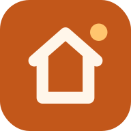
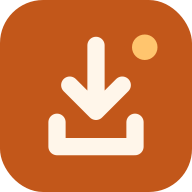

<h1 align="center">sDash</h1>

<b>Toute la maison sur une tablette. Un regard pour savoir, un geste pour agir.</b>

  
  

Lumières, chauffage, volets, télés, aspirateur, ordinateurs : sDash réunit toute votre
maison connectée sur un seul écran, clair et lisible de loin. Posée sur un meuble ou
fixée au mur, la tablette devient le tableau de bord de la maison, que toute la famille
comprend du premier coup.

## Pourquoi sDash

- **Tout sur un écran.** Plus besoin de jongler entre cinq applications : l'essentiel de la
  maison tient sur l'accueil, et chaque appareil a sa page détaillée.
- **Lisible d'un coup d'œil.** Une tuile ambrée est allumée, une tuile neutre est éteinte.
  Pas de menu à fouiller : on voit, on touche, c'est fait.
- **Pensé pour tous.** Gros boutons, texte contrasté, commandes qui ressemblent à celles des
  interrupteurs muraux : conçu pour que les enfants comme les grands-parents s'en servent
  sans explication.

## Ce que fait sDash

| | |
| --- | --- |
|  |  |
|  |  |

### 💡 Lumières
Une tuile par lampe, la luminosité au doigt, un interrupteur par pièce, et « tout éteindre »
en partant.

### 🌡️ Chauffage
Gros boutons − et + par demi-degré, la température mesurée dans chaque pièce, et les modes
Confort, Éco, Hors-gel et Arrêt.

### 🪟 Volets
Monter, arrêter, descendre, comme au mur. Sur la page Volets, faites glisser le volet
dessiné pour l'arrêter exactement où vous voulez.

### 📺 Télés et enceintes
Allumer, éteindre, mettre en pause, régler le volume. Même une télé qui ne sait pas
s'éteindre toute seule s'éteint avec le boîtier branché dessus.

### 🧹 Aspirateur robot
Son état et sa batterie d'un coup d'œil ; lancez le ménage, mettez en pause ou renvoyez-le
à sa base.

### 🖥️ Ordinateurs
Allumez le PC du bureau ou le NAS à distance depuis la tablette (Wake-on-LAN), voyez s'ils
sont en ligne, éteignez-les quand vous voulez.

### ✨ Scènes, prises et consommation
« Soirée cosy », « Cinéma », « Bonne nuit » : une scène règle toute la pièce d'un geste.
Les prises connectées se commandent comme le reste, et la consommation des sept derniers
jours s'affiche sur l'accueil.

### 🌗 Clair ou sombre, jour et nuit
Le thème suit celui de la tablette : clair le jour, sombre le soir. Pour une tablette
murale, l'écran reste allumé et passe en plein écran.

## Compatible Home Assistant

sDash se connecte à [Home Assistant](https://www.home-assistant.io) en deux minutes : une
adresse, un jeton, et vos pièces et appareils apparaissent. Les changements arrivent en
temps réel et la connexion se rétablit seule en cas de coupure.

Pas encore de domotique ? Le **mode démo**, actif par défaut, simule une maison complète
pour tout essayer sans rien configurer.

## Prise en main

1. **Téléchargez** `sdash.apk` sur la tablette avec le bouton en haut de cette page, ouvrez-le
   et autorisez l'installation si Android le demande.
2. **Découvrez** sDash en mode démo, avec sa maison simulée.
3. **Connectez** votre Home Assistant dans **Réglages → Connexion domotique**.

Le [guide d'utilisation](docs/GUIDE.md) détaille la connexion à Home Assistant, les appareils
pris en charge et l'allumage des ordinateurs.

## Questions fréquentes

**Faut-il un compte ou un abonnement ?** Non. sDash est gratuit et parle directement à votre
Home Assistant, sur votre réseau, sans passer par un service en ligne.

**Sur quels appareils ?** Toute tablette ou tout téléphone Android. L'interface se réorganise
selon la taille de l'écran, en paysage comme en portrait.

**Et si j'utilise une autre domotique ?** sDash est prévu pour accueillir d'autres systèmes ;
Home Assistant est le premier pris en charge.

## La famille sPack

sDash fait partie de **sPack**, une famille d'applications pratiques pour la maison, toutes
dans le même style.

| | | |
| :---: | :---: | :---: |
|  |  |  |
| **sDash** Toute la maison sur une tablette | **[sPhone](https://github.com/ShinezeoGame/sPhone)** L'écran du téléphone sur le PC | **[sDrop](https://github.com/ShinezeoGame/sDrop)** Fichiers et textes entre téléphone et PC |

---

Développement, organisation du code et logo : voir [docs/DEVELOPPEMENT.md](docs/DEVELOPPEMENT.md).
Police [Outfit](https://github.com/Outfitio/Outfit-Fonts) sous licence SIL Open Font License 1.1.
