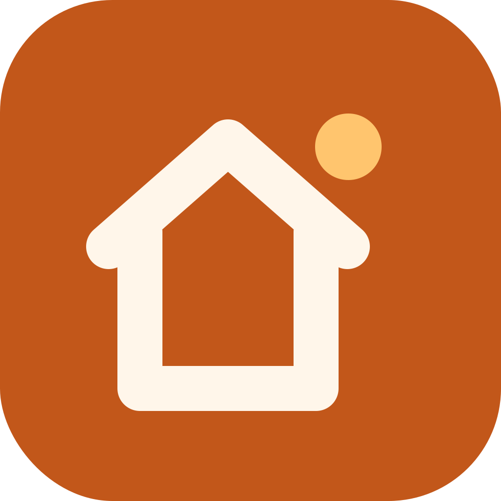
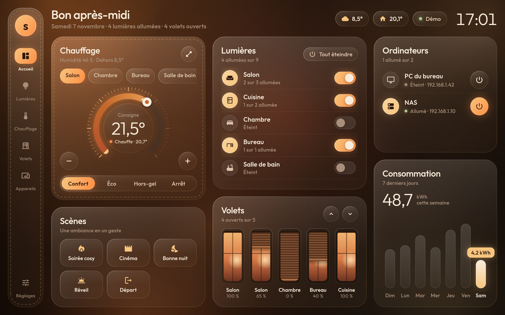
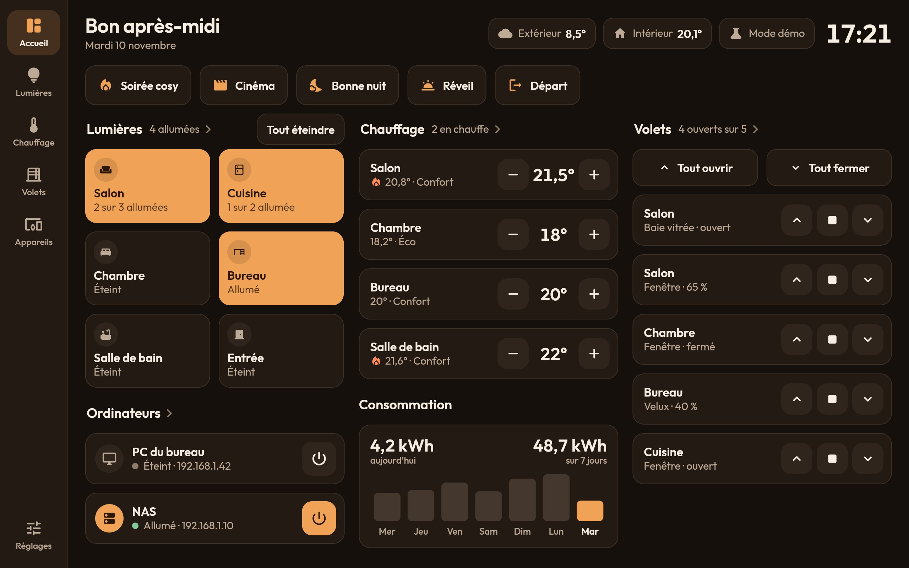
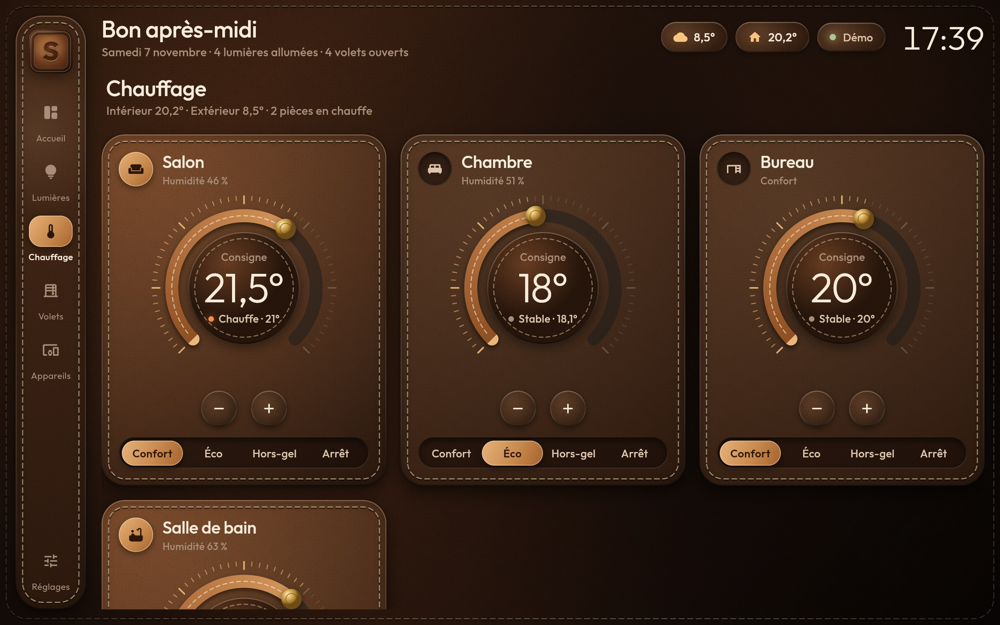
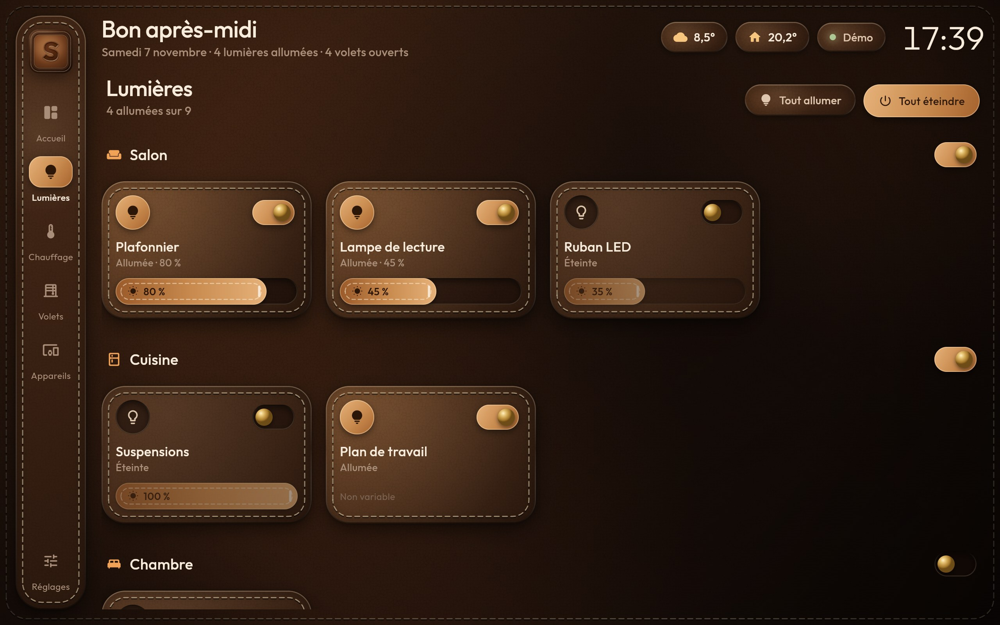
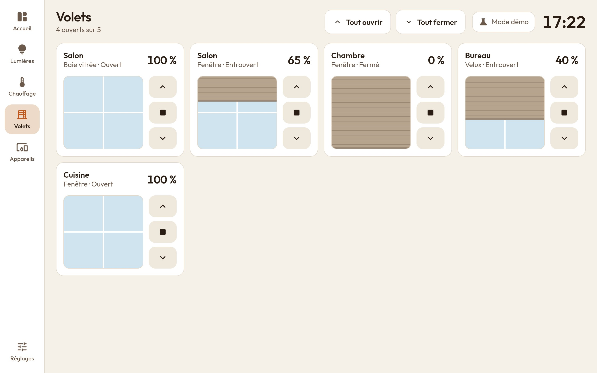
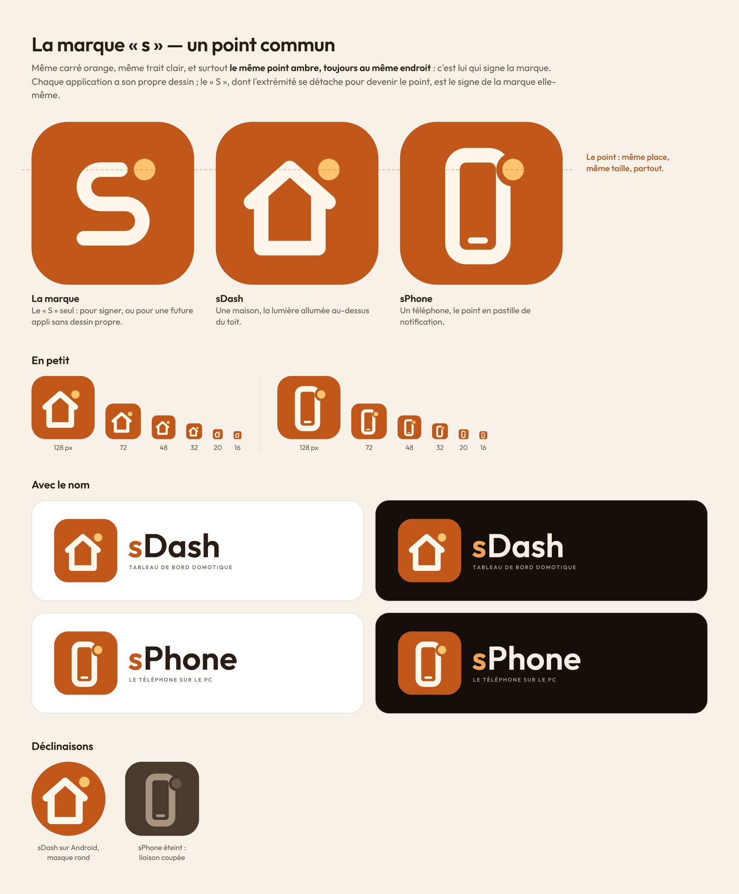

<p align="center"></p>

# sDash

Tableau de bord domotique pour tablette Android : lumières, chauffage, volets, prises,
scènes et réveil des ordinateurs, dans une interface claire, lisible de loin et pensée
pour que chaque action se fasse en un geste.

<p align="center">
  <a href="https://github.com/ShinezeoGame/sDash/releases/latest/download/sdash.apk"></a>
  <a href="https://github.com/ShinezeoGame/sDash/releases/latest"></a>
</p>



| Thème sombre | Chauffage |
| --- | --- |
|  |  |

| Lumières | Volets |
| --- | --- |
|  |  |

## Fonctionnalités

- **Accueil** : tout ce qui sert au quotidien tient sur un écran de tablette en paysage et
  se commande en un geste — scènes, lumières par pièce, chauffage, volets, ordinateurs,
  consommation de la semaine. La page se réorganise et défile sur les écrans plus petits.
- **L'état se lit d'un coup d'œil** : une tuile ambrée est allumée, une tuile neutre est
  éteinte. Toucher la tuile bascule l'appareil.
- **Lumières** : une tuile par lampe, curseur de luminosité, interrupteur par pièce,
  « tout allumer » / « tout éteindre ».
- **Chauffage** : gros boutons − et + (pas de 0,5°), température mesurée, modes
  Confort / Éco / Hors-gel / Arrêt.
- **Volets** : boutons monter / stop / descendre comme sur un interrupteur mural ; sur la
  page Volets, faites glisser le volet dessiné pour choisir une position précise.
- **Appareils** : prises connectées, scènes, et ordinateurs (allumage par Wake-on-LAN,
  état en ligne, extinction facultative).
- **Thème clair ou sombre** (Réglages → Affichage) : automatique selon la tablette par
  défaut, donc clair le jour et sombre la nuit si la tablette est réglée ainsi.
- **Tablette murale** : écran toujours allumé et plein écran.
- **Mode démo** : une maison simulée complète, active par défaut, pour tout essayer sans rien configurer.

### Parti pris de l'interface

Fonctionnelle avant tout : surfaces unies sans texture ni effet, texte grand et contrasté
(niveau AA des règles d'accessibilité WCAG), zones tactiles d'au moins 44 px, une seule
couleur d'accent, et les mêmes composants sur toutes les pages. Les tons chauds (crème,
brun, ambre) rappellent le logo en cuir sans nuire à la lisibilité.

## Installer l'application sur la tablette

1. Depuis la tablette, appuyez sur le bouton **Télécharger la dernière version** en haut de
   cette page (fichier `sdash.apk`).
2. Ouvrez le fichier téléchargé et autorisez l'installation d'applications de sources
   inconnues si Android le demande.

L'APK est compilé par GitHub Actions et publié dans les
[Releases](https://github.com/ShinezeoGame/sDash/releases) à chaque envoi sur la branche
par défaut. Les compilations des autres branches restent disponibles en artefact
**sdash-apk** dans l'onglet **Actions** (connexion à GitHub requise).

Pour compiler soi-même : `flutter build apk --release` (Flutter 3.47 et le SDK Android requis).

## Connecter Home Assistant

1. Dans Home Assistant : **Profil → Sécurité → Jetons d'accès longue durée** → créez un jeton.
2. Dans sDash : **Réglages → Connexion domotique → Home Assistant**, saisissez l'adresse
   (ex. `http://192.168.1.10:8123`) et le jeton, puis **Enregistrer**.

La connexion utilise l'API WebSocket : les changements d'état arrivent en temps réel et la
connexion se rétablit seule en cas de coupure. Les pièces sont celles définies dans
Home Assistant (zones). Entités prises en charge :

| Domaine | Dans sDash |
| --- | --- |
| `light` | Lumières (variation si l'ampoule la gère) |
| `climate` | Thermostats ; modes via les préréglages `comfort`, `eco`, `away` / `frost_protection` |
| `cover` | Volets (position si disponible, sinon ouvrir / fermer) |
| `switch` | Prises et appareils |
| `scene`, `script` | Scènes |
| `weather` | Température extérieure |

Les entités masquées, désactivées ou techniques (configuration, diagnostic) sont ignorées.
Le champ facultatif **Capteur d'énergie** (ex. `sensor.compteur_energie`) affiche la
consommation des 7 derniers jours ; sans lui, la carte montre les températures par pièce.

## Allumer un ordinateur

**Réglages → Ordinateurs → Ajouter**, deux possibilités :

- **Wake-on-LAN direct** depuis la tablette : renseignez l'adresse MAC de la carte réseau
  (le Wake-on-LAN doit être activé dans le BIOS/UEFI et dans les propriétés de la carte réseau).
  L'adresse IP, facultative, permet d'afficher si la machine est allumée. L'URL d'extinction,
  facultative, est appelée en `POST` (par exemple un petit service d'extinction installé sur le PC).
- **Entité Home Assistant** (ex. `switch.pc_bureau` de l'intégration Wake on LAN) :
  prioritaire en mode Home Assistant, l'allumage et l'extinction passent par Home Assistant.

La tablette doit être sur le même réseau local que l'ordinateur pour le réveil direct.

## Clé de signature (facultatif)

Sans configuration, l'APK est signé avec une clé de débogage différente à chaque compilation :
il faut alors désinstaller l'ancienne version avant d'installer la nouvelle. Pour des mises à jour
directes, créez une clé une fois pour toutes :

```bash
keytool -genkey -v -keystore sdash.jks -keyalg RSA -keysize 2048 -validity 10000 -alias sdash
```

puis ajoutez ces deux secrets au dépôt (**Settings → Secrets and variables → Actions**) :
`ANDROID_KEYSTORE_BASE64` (résultat de `base64 -w0 sdash.jks`) et `ANDROID_KEYSTORE_PASSWORD`.
`ANDROID_KEY_ALIAS` (par défaut `sdash`) et `ANDROID_KEY_PASSWORD` (par défaut le même mot de passe)
sont facultatifs. Ne versionnez jamais le fichier `.jks` et gardez-en une copie : sans lui, la
version suivante devra de nouveau être installée après désinstallation.

## Développement

```bash
flutter pub get
```

```bash
flutter test
```

```bash
flutter run -d chrome
```

L'aperçu navigateur fonctionne en mode démo et Home Assistant ; le Wake-on-LAN direct n'est
disponible que sur la tablette.

### Organisation du code

| Dossier | Rôle |
| --- | --- |
| `lib/models/` | Modèles de la maison (pièces, appareils, état complet) |
| `lib/data/` | Sources domotiques : démo, Home Assistant, réseau local (Wake-on-LAN), réglages |
| `lib/state/` | `HomeController` : relie l'interface, les réglages et la source domotique |
| `lib/ui/theme.dart` | Couleurs par rôle (thèmes clair et sombre), styles de texte, dimensions |
| `lib/ui/widgets/` | Composants : tuiles, boutons, interrupteur, curseur, volet, histogramme |
| `lib/ui/pages/` | Accueil, pages détaillées et réglages |
| `lib/ui/shell.dart` | Navigation (barre latérale sur tablette, barre du bas sur téléphone) |

Pour brancher un autre système domotique (Jeedom, Domoticz, MQTT…), il suffit d'implémenter
l'interface `HomeBackend` (`lib/data/home_backend.dart`).

## Logo

sDash partage sa marque avec [sPhone](https://github.com/ShinezeoGame/sPhone) : le même carré
orange, le même trait clair, et le même point ambre, toujours au même endroit. Seul le
dessin change — ici une maison, dont le point est la lumière allumée. Le « S » seul, dont
l'extrémité se détache pour devenir le point, est le signe de la marque.



Les sources vectorielles sont dans `docs/logo/` et se régénèrent avec
`python3 tools/logo/generer_logo.py assets/fonts docs/logo` ; les PNG (icônes Android et web,
logo de l'application) s'exportent ensuite avec `python3 tools/logo/exporter.py`.

## Licences

Police [Outfit](https://github.com/Outfitio/Outfit-Fonts) sous licence SIL Open Font License 1.1
(`assets/fonts/OFL.txt`).
