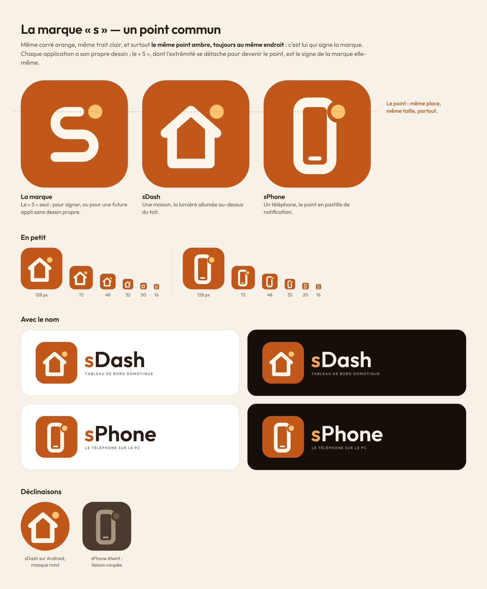

# Développement de sDash

[← Retour à la présentation](../README.md)

Application [Flutter](https://flutter.dev) 3.47, Android d'abord.

```bash
flutter pub get
```

```bash
flutter test
```

```bash
flutter run -d chrome
```

L'aperçu navigateur fonctionne en mode démo et Home Assistant ; le Wake-on-LAN direct n'est
disponible que sur la tablette. Pour compiler l'APK : `flutter build apk --release` (SDK
Android requis).

## Organisation du code

| Dossier | Rôle |
| --- | --- |
| `lib/models/` | Modèles de la maison (pièces, appareils, état complet) |
| `lib/data/` | Sources domotiques : démo, Home Assistant, réseau local (Wake-on-LAN), réglages |
| `lib/state/` | `HomeController` : relie l'interface, les réglages et la source domotique |
| `lib/ui/theme.dart` | Couleurs par rôle (thèmes clair et sombre), styles de texte, dimensions |
| `lib/ui/widgets/` | Composants : tuiles, boutons, interrupteur, curseur, volet, histogramme |
| `lib/ui/pages/` | Accueil, pages détaillées et réglages |
| `lib/ui/shell.dart` | Navigation (barre latérale sur tablette, barre du bas sur téléphone) |

Pour brancher un autre système domotique (Jeedom, Domoticz, MQTT…), il suffit d'implémenter
l'interface `HomeBackend` (`lib/data/home_backend.dart`).

## Compilation automatique

`.github/workflows/build-apk.yml` analyse, teste et compile l'APK à chaque envoi
(artefact **sdash-apk**), et le publie en Release (`sdash.apk`) sur la branche par défaut.

### Clé de signature (facultatif)

Sans configuration, l'APK est signé avec une clé de débogage différente à chaque compilation :
il faut alors désinstaller l'ancienne version avant d'installer la nouvelle. Pour des mises à jour
directes, créez une clé une fois pour toutes :

```bash
keytool -genkey -v -keystore sdash.jks -keyalg RSA -keysize 2048 -validity 10000 -alias sdash
```

puis ajoutez ces deux secrets au dépôt (**Settings → Secrets and variables → Actions**) :
`ANDROID_KEYSTORE_BASE64` (résultat de `base64 -w0 sdash.jks`) et `ANDROID_KEYSTORE_PASSWORD`.
`ANDROID_KEY_ALIAS` (par défaut `sdash`) et `ANDROID_KEY_PASSWORD` (par défaut le même mot de passe)
sont facultatifs. Ne versionnez jamais le fichier `.jks` et gardez-en une copie : sans lui, la
version suivante devra de nouveau être installée après désinstallation.

## Logo

sDash fait partie de la marque **sPack**, avec [sPhone](https://github.com/ShinezeoGame/sPhone)
et [sDrop](https://github.com/ShinezeoGame/sDrop) : même carré orange, même trait clair, un
dessin centré propre à chaque application (ici une maison), et le même point ambre posé dans
l'angle en haut à droite.



Les sources vectorielles sont dans `docs/logo/` et se régénèrent avec
`python3 tools/logo/generer_logo.py assets/fonts docs/logo` ; les PNG (icônes Android et web,
logo de l'application) s'exportent ensuite avec `python3 tools/logo/exporter.py`.

## Licences

Police [Outfit](https://github.com/Outfitio/Outfit-Fonts) sous licence SIL Open Font License 1.1
(`assets/fonts/OFL.txt`).
